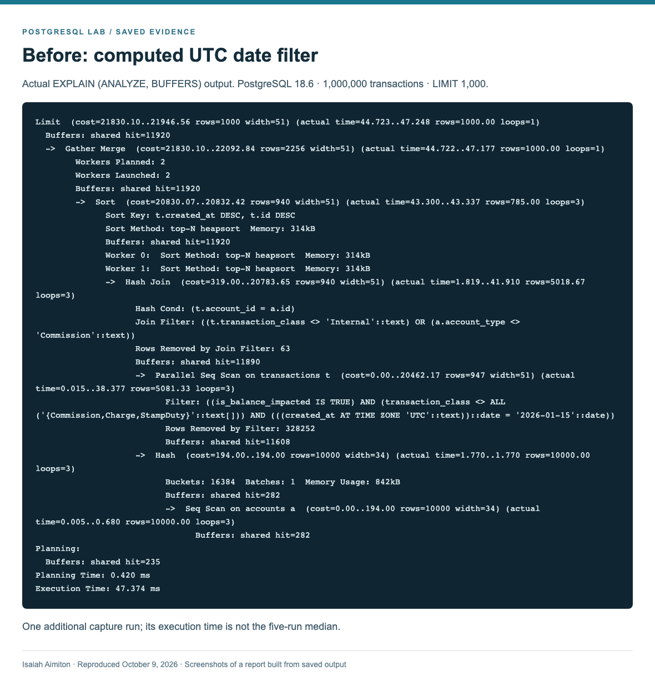
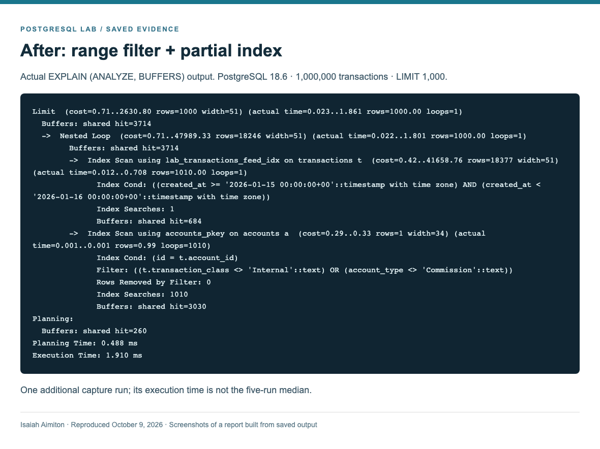
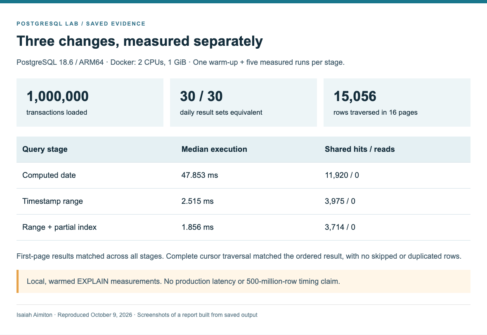
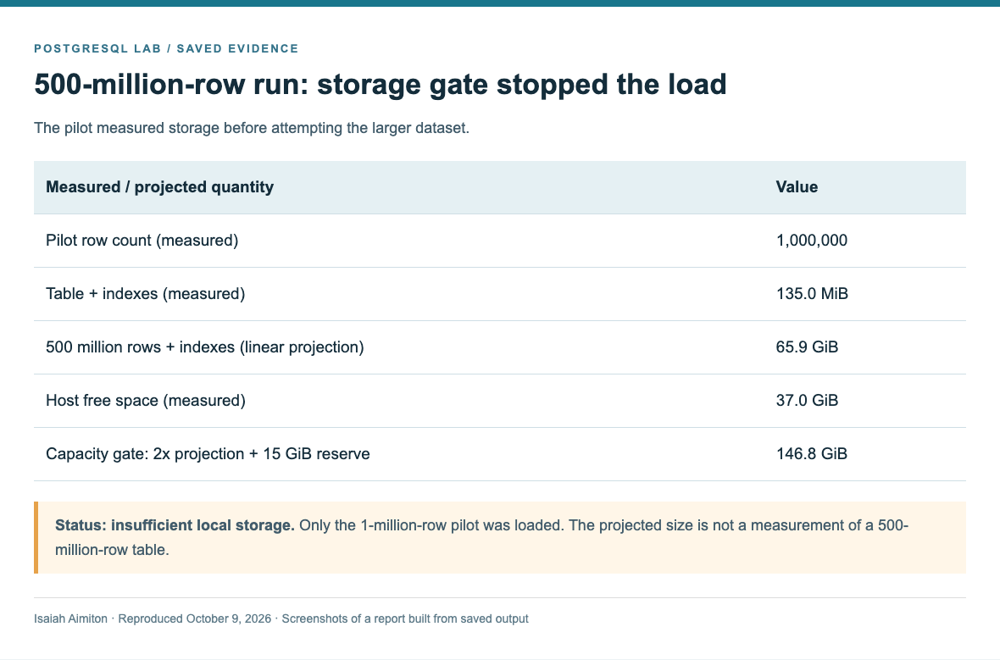

# Before 500 Million Rows: Fix the PostgreSQL Query That Already Does Too Much Work

*A practical investigation of query plans, date filters, and indexes - and how to catch expensive work before your transaction table grows.*

By Isaiah Aimiton

Imagine a transaction table growing toward 500 million rows. Your API still needs only the newest 1,000 transactions for a day. The response has barely changed, but the database work behind it can grow dramatically.

Yet a small response does not necessarily mean a small amount of work. PostgreSQL may still scan a large part of the table, reject most of those rows, and sort the survivors before returning the page.

The useful question is not simply, "Which index should I add?" It is: **What work does this query make the database do, and which change removes that work?**

This guide answers that question in three stages. We will measure a computed date filter, replace it with a timestamp range, and then add an index that matches the filtered ordering. Afterward, we will check that the results still agree and that pagination does not skip records.

The examples use synthetic payment data. The reproduced dataset contains **one million transactions**, not 500 million. A storage preflight prevented the requested 500-million-row run on the available machine; the final section explains that boundary and how to attempt the larger run on a suitable host.

## What you will need

Use a disposable database. The SQL targets PostgreSQL 17 or later; the recorded runs used PostgreSQL 18.6. The automated project needs Python 3.9+ and Docker, with no additional Python packages.

Extract the accompanying project, open its directory, and run:

```sh
python3 run.py
```

The runner creates its own isolated container, loads the data, records plans, validates results, and removes its container. It writes evidence to `results/`. It does not connect to your existing databases.

To follow along manually, run the SQL below in order using psql or another SQL client with autocommit enabled. Do not rerun the insert in the same schema: that adds another dataset. Start with a fresh disposable database for each comparison.

## 1. Build a small but useful transaction dataset

We need two tables: accounts and transactions. Amounts use integer minor units so the example does not depend on floating-point arithmetic.

```sql
CREATE SCHEMA query_lab;

CREATE TABLE query_lab.accounts (
    id bigint PRIMARY KEY,
    display_name text NOT NULL,
    account_type text NOT NULL,
    updated_at timestamptz NOT NULL DEFAULT now()
);

CREATE TABLE query_lab.transactions (
    id bigint GENERATED ALWAYS AS IDENTITY PRIMARY KEY,
    account_id bigint NOT NULL
        REFERENCES query_lab.accounts(id),
    created_at timestamptz NOT NULL,
    amount_minor bigint NOT NULL,
    status text NOT NULL,
    transaction_class text NOT NULL,
    is_balance_impacted boolean NOT NULL,
    reference text NOT NULL
);
```

The primary keys receive indexes automatically. The foreign key does not create an index on `transactions.account_id`. That is a separate decision, and it is not the first fix for this feed query.

Create 10,000 accounts:

```sql
INSERT INTO query_lab.accounts
    (id, display_name, account_type)
SELECT
    n,
    'Demo Account ' || n,
    CASE WHEN n % 20 = 0
         THEN 'Commission' ELSE 'Customer' END
FROM generate_series(1, 10000) AS g(n);
```

Now load one million transactions across 30 UTC dates:

```sql
INSERT INTO query_lab.transactions (
    account_id, created_at, amount_minor, status,
    transaction_class, is_balance_impacted, reference
)
SELECT
    1 + ((hashtextextended(n::text, 11) & 9223372036854775807) % 10000),
    timestamptz '2026-01-01 00:00:00+00'
        + ((n % 30)::int * interval '1 day')
        + ((((n - 1) / 300) % 86400)::int * interval '1 second'),
    100 + ((n * 7919) % 1000000),
    CASE WHEN n % 9 = 0 THEN 'Pending' ELSE 'Successful' END,
    CASE n % 7
        WHEN 0 THEN 'Commission'
        WHEN 1 THEN 'Charge'
        WHEN 2 THEN 'StampDuty'
        WHEN 3 THEN 'Internal'
        ELSE 'Transfer'
    END,
    (hashtextextended(n::text, 23) & 9223372036854775807) % 5 <> 0,
    'LAB-' || n
FROM generate_series(1::bigint, 1000000::bigint) AS g(n);

ANALYZE query_lab.accounts;
ANALYZE query_lab.transactions;
```

Each day contains repeated timestamps, so ordering by the timestamp alone would not be deterministic. The transaction ID will serve as a tie-breaker.

The seeded hashes vary account assignments and balance flags independently of the date arithmetic. This matters: a simpler modulo-based generator accidentally made some filters always pass on particular days. The revised generator exercises those conditions. It remains synthetic data, and hash outputs need not be stable across major PostgreSQL versions.

This lab intentionally includes both pending and successful transactions. If a real endpoint should return only successful transactions, add that rule consistently to every compared query and reconsider the index predicate.

## 2. Capture the plan for the original query

Start with a basic timestamp index:

```sql
CREATE INDEX lab_transactions_created_at_idx
ON query_lab.transactions (created_at);
```

The feed asks for January 15 in UTC, excludes several transaction classes, and excludes internal transactions belonging to commission accounts. This first version converts each timestamp to a date:

```sql
EXPLAIN (ANALYZE, BUFFERS)
SELECT
    t.id, t.created_at, t.amount_minor, t.status,
    a.display_name
FROM query_lab.transactions AS t
JOIN query_lab.accounts AS a ON a.id = t.account_id
WHERE (t.created_at AT TIME ZONE 'UTC')::date
          = DATE '2026-01-15'
  AND t.is_balance_impacted IS TRUE
  AND t.transaction_class
          NOT IN ('Commission', 'Charge', 'StampDuty')
  AND NOT (
      t.transaction_class = 'Internal'
      AND a.account_type = 'Commission'
  )
ORDER BY t.created_at DESC, t.id DESC
LIMIT 1000;
```

`EXPLAIN ANALYZE` executes the query. Save the output before changing anything.

The ordinary index contains timestamps. The condition compares a computed date expression, so that index cannot directly turn the date comparison into a selective range lookup. PostgreSQL may instead scan rows and apply the expression as a filter.

Read the plan from the scans upward. Look for the following evidence:

- **Rows removed by a filter:** How much data was examined and then discarded?
- **Index Cond versus Filter:** Did the condition narrow the index scan, or was it checked after fetching candidates?
- **Sort nodes:** Did PostgreSQL need a separate sort to produce the requested order?
- **Loops and buffers:** How often was work repeated, and how many shared buffer accesses were recorded?

A sequential scan is not automatically a mistake. A nested loop is not automatically slow. Their usefulness depends on the amount of work required for this particular request.

Parent timings and buffer counts include child work, so do not sum every node. Shared hits count accesses to cached pages, not distinct pages. Parallel workers also overlap; adding their timings does not give wall-clock duration.



*Figure 1. Screenshot of the saved-output report from the reproduced one-million-row lab. The text is actual EXPLAIN output; this is not a 500-million-row run.*

## 3. Make the date condition a timestamp range

Express the day using an inclusive start and an exclusive end:

```sql
EXPLAIN (ANALYZE, BUFFERS)
SELECT
    t.id, t.created_at, t.amount_minor, t.status,
    a.display_name
FROM query_lab.transactions AS t
JOIN query_lab.accounts AS a ON a.id = t.account_id
WHERE t.created_at >= timestamptz '2026-01-15 00:00:00+00'
  AND t.created_at <  timestamptz '2026-01-16 00:00:00+00'
  AND t.is_balance_impacted IS TRUE
  AND t.transaction_class
          NOT IN ('Commission', 'Charge', 'StampDuty')
  AND NOT (
      t.transaction_class = 'Internal'
      AND a.account_type = 'Commission'
  )
ORDER BY t.created_at DESC, t.id DESC
LIMIT 1000;
```

The meaning is unchanged: include timestamps on or after midnight on January 15, and stop before midnight on January 16. Adjacent windows do not overlap.

The important change is that PostgreSQL can now compare the stored column directly with the bounds. The existing timestamp index becomes eligible for a range lookup. The planner still decides whether that path is worthwhile.

For a local calendar day, derive both boundaries in the reporting time zone. Do not assume every local day lasts exactly 24 hours when daylight-saving transitions are possible.

An expression index is another option for a computed-date predicate. A timestamp range is useful here because the same form also supports hours, days, and arbitrary intervals.

**Run this query before adding the next index.** Otherwise, you will not know how much of the improvement came from the rewrite alone.

## 4. Match the index to the filtered ordering

The query orders by timestamp and ID, while always excluding the same transaction-only conditions. A partial composite index can encode both choices:

```sql
CREATE INDEX lab_transactions_feed_idx
ON query_lab.transactions (created_at DESC, id DESC)
WHERE is_balance_impacted IS TRUE
  AND transaction_class
          NOT IN ('Commission', 'Charge', 'StampDuty');

ANALYZE query_lab.transactions;
```

Rerun the range query from the previous section.

This index holds only rows that satisfy its predicate and orders them by the two requested keys. If PostgreSQL uses that ordering through the join, it can avoid a separate sort and stop once it has enough eligible results.

The account-dependent condition stays in the query. An index on transactions cannot use a predicate that reads another table.

Keep the partial-index predicate fixed in the query. PostgreSQL must establish that the query implies the predicate when planning; replacing the class or flag conditions with parameters can prevent that proof in a generic prepared plan. Date and cursor parameters do not change the fixed predicate shown here.



*Figure 2. Actual saved EXPLAIN output from the optimized stage. Compare the access path and sorting work with Figure 1, as well as the execution time.*

The lab uses an ordinary index build because it has no concurrent traffic. On a live system, evaluate `CREATE INDEX CONCURRENTLY`, its extra work, and its restriction against running inside a transaction block. Every added index also costs disk space and write work; keep it only if the workload justifies it.

## 5. Compare measured work, not just a faster-looking number

The report below comes from a fresh reproduction of the lab. It uses PostgreSQL 18.6 on ARM64, running in Docker with 2 CPUs and a 1 GiB memory limit. Shared buffers are 128 MiB and work_mem is 4 MiB.

Each stage receives one warm-up and five measured EXPLAIN runs. The table reports median database execution times; buffer counts come from the final measured plan. Additional text plans are saved for the screenshots, so their individual times need not equal the medians.

| Query | Median execution | Access path | Sort | Shared hits / reads |
| --- | --- | --- | --- | --- |
| Computed date | 47.853 ms | Parallel sequential scan | Yes | 11,920 / 0 |
| Timestamp range | 2.515 ms | Timestamp index scan | Incremental | 3,975 / 0 |
| Range + partial index | 1.856 ms | Partial composite index | No | 3,714 / 0 |




*Figure 3. Screenshot of the local evidence report, generated from the saved JSON results. The dataset size and validation scope are shown explicitly.*

The first change removes the expensive computed-date filtering path. The second improves how PostgreSQL produces the requested ordering. The raw plans tell you which work changed; the repeated timings tell you how that affected this run.

These are sequential runs with warmed caches and EXPLAIN instrumentation. They are not application response times, cold-cache measurements, or a concurrent-load test. Other queries running on the host can affect the results. Do not extrapolate the timing ratio to a production workload or a much larger table.

A faster answer must still be the same answer. The one-million-row runner checks identical ordered first-page records across all three stages, complete computed-date/range equivalence for all 30 days, and a full cursor traversal against the complete ordered result for January 15. The recorded traversal contains 15,056 rows across 16 pages.

## 6. Use the last row as the next-page cursor

For newest-first ordering, the next page should begin below the last returned `(created_at, id)` pair. Keep every existing filter and add this condition:

```sql
AND (t.created_at, t.id) < (
    $1::timestamptz,
    $2::bigint
)
ORDER BY t.created_at DESC, t.id DESC
LIMIT 1000;
```

The strict comparison excludes the last row itself. The ID resolves timestamp ties, preventing tied records from being skipped merely because they share the same timestamp.

`$1` and `$2` are bound parameters, not values that an unprepared SQL client can execute by itself. For a copyable SQL-client version, prepare the full query:

```sql
PREPARE lab_next_page (timestamptz, bigint) AS
SELECT t.id, t.created_at, t.amount_minor, t.status,
       a.display_name
FROM query_lab.transactions AS t
JOIN query_lab.accounts AS a ON a.id = t.account_id
WHERE t.created_at >= timestamptz '2026-01-15 00:00:00+00'
  AND t.created_at <  timestamptz '2026-01-16 00:00:00+00'
  AND t.is_balance_impacted IS TRUE
  AND t.transaction_class
          NOT IN ('Commission', 'Charge', 'StampDuty')
  AND NOT (t.transaction_class = 'Internal'
           AND a.account_type = 'Commission')
  AND (t.created_at, t.id) < ($1, $2)
ORDER BY t.created_at DESC, t.id DESC
LIMIT 1000;
```

Execute it in the same session using the actual timestamp and ID from the last row of your previous page. For example, only if that row contained these values:

```sql
EXECUTE lab_next_page ('2026-01-15 00:00:10+00', 3014);
```

Keyset pagination avoids discarding a growing offset during sequential browsing. It does not provide direct page-number jumps, and it does not freeze a changing dataset. Concurrent updates to ordering or filter columns can change what subsequent requests see.

## 7. Check maintenance as a separate part of the investigation

An efficient predicate and index do not replace vacuuming or current planner statistics. Begin with a table-health check:

```sql
SELECT relname, n_live_tup, n_dead_tup,
       last_vacuum, last_autovacuum,
       last_analyze, last_autoanalyze
FROM pg_stat_user_tables
WHERE schemaname = 'query_lab';
```

To observe update activity in this disposable lab:

```sql
UPDATE query_lab.accounts
SET display_name = display_name || ' revised',
    updated_at = now()
WHERE id % 3 = 0;
```

Updates create old row versions, but this command does not guarantee a large visible dead-tuple count. Pruning, autovacuum, and statistics-reporting delays can affect the estimate.

After the update commits, run maintenance outside a transaction block:

```sql
VACUUM (ANALYZE, VERBOSE) query_lab.accounts;
```

VACUUM makes eligible dead-row space reusable; ANALYZE refreshes planner statistics. Ordinary vacuum generally does not return all that reusable space to the operating system.

If cleanup appears stalled, inspect sessions holding transaction or snapshot state:

```sql
SELECT pid, state,
       now() - xact_start AS transaction_age,
       wait_event_type, wait_event
FROM pg_stat_activity
WHERE datname = current_database()
  AND (xact_start IS NOT NULL OR backend_xmin IS NOT NULL)
  AND pid <> pg_backend_pid()
ORDER BY xact_start NULLS LAST;
```

This includes idle-in-transaction sessions. It is a diagnostic starting point, not a complete check of replication slots, prepared transactions, or every cleanup horizon.

## 8. What changes at 500 million rows?

The requested larger experiment begins with a capacity check. In the reproduced pilot, the transaction table and its indexes occupied approximately **135 MiB for one million rows**. Linear scaling projects roughly **66 GiB for 500 million rows**, before allowing for loading and index-build overhead.

The Mac had approximately **37 GiB free**. The runner therefore stopped before attempting the larger load. Its conservative capacity gate requires about **147 GiB free**, based on twice the projected relation size plus a 15 GiB reserve. That is a planning heuristic, not a guarantee of sufficient storage.



*Figure 4. Actual preflight report. The relation-size estimate is a projection; no 500-million-row query benchmark was completed.*

On a Docker host with sufficient physical storage, the companion command is:

```sh
python3 run_scale.py --rows 500000000
```

The runner measures a fresh one-million-row pilot, checks host and container free space, and only then continues in batches. It retains plans and environment details under `results-scale/`. At larger scales, its result checks cover the first page and the first 10,000 rows of cursor traversal; it does not claim the pilot's exhaustive daily checks were repeated. The run can take substantial time, and successful startup does not guarantee that all later resource requirements will fit.

For maintenance planning, PostgreSQL 17's basic dead-tuple vacuum threshold is:

```text
base threshold + scale factor x estimated table row count
```

With 500 million estimated rows, a base threshold of 50 and a scale factor of 0.2 give 100,000,050. A base threshold of 10,000 and a scale factor of 0.005 give 2,510,000.

PostgreSQL 18 also caps the calculated threshold with `autovacuum_vacuum_max_threshold`, which defaults to 100 million; -1 disables that cap. These eligibility calculations do not promise when a worker will run. Insert and freeze triggers, worker capacity, and old snapshots also matter.

For a controlled experiment, the following table options are available:

```sql
ALTER TABLE query_lab.transactions SET (
    autovacuum_vacuum_scale_factor = 0.005,
    autovacuum_vacuum_threshold = 10000,
    autovacuum_analyze_scale_factor = 0.005,
    autovacuum_analyze_threshold = 10000
);
```

These values are examples, not a production recommendation. Analyze responds to changed tuples; the dead-tuple vacuum calculation describes a different trigger. Monitor both the frequency of maintenance and its resource cost.

Time partitioning may help with retention and some range access patterns at this scale, but it introduces its own operational decisions. It does not replace selective predicates or indexes that match the query.

## A practical checklist for your next slow query

Capture the SQL and its plan before making changes. Rewrite one predicate at a time, then test an index that matches the access pattern. Preserve the plans, compare repeatable measurements, and verify the ordered results. Finally, test the endpoint under representative application load: a faster database query is one part of a faster request.

The lesson from this lab is concrete: a request for 1,000 rows can make PostgreSQL inspect far more data than it returns. Start by finding that unnecessary work in the execution plan.

## Code and references

The companion archive includes SQL files, Python runners, raw JSON and text plans, capacity evidence, and the screenshots used above. Screenshot HTML is a presentation of saved output, not a live terminal capture.

- [Using EXPLAIN](https://www.postgresql.org/docs/17/using-explain.html)
- [Indexes on expressions](https://www.postgresql.org/docs/17/indexes-expressional.html)
- [Partial indexes](https://www.postgresql.org/docs/17/indexes-partial.html)
- [Routine vacuuming](https://www.postgresql.org/docs/17/routine-vacuuming.html)
- [PostgreSQL 18 vacuum settings](https://www.postgresql.org/docs/18/runtime-config-vacuum.html)
